# William Tool

Bộ công cụ nội bộ cho team dev/QC: đọc log, đọc / tạo mã QR, giải mã Watane, kho lệnh dùng chung, tài khoản test dùng chung và chấm giờ OT.
Là một trang web đơn (React + Supabase), build ra đúng một file `dist/index.html`, cài được như app trên máy tính và điện thoại.

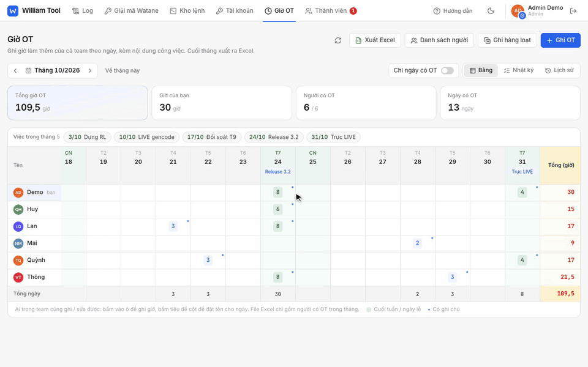

Bản video rõ hơn: [docs/media/demo.mp4](docs/media/demo.mp4). Mọi ảnh và video trong README dùng dữ liệu giả của chế độ demo.

## Các tab

| Tab | Dùng để | Dữ liệu nằm ở đâu |
|---|---|---|
| Log | Mở file / thư mục log, tìm kiếm, gom lỗi, lần theo trace id | Chỉ trong trình duyệt, không gửi đi đâu |
| Tiện ích | Đọc và tạo mã QR (tách VietQR, kiểm tra CRC); giải mã / mã hoá code Watane, dán tay hoặc chạy cả file CSV / Excel | Chỉ trong trình duyệt |
| Kho lệnh | Lệnh shell / SQL hay dùng, có tham số `{{tên:mặc định}}` điền trước khi copy | Supabase |
| Tài khoản | Tài khoản test dùng chung theo hệ thống và môi trường, hiện mã OTP trực tiếp, phân quyền từng tài khoản | Supabase |
| Giờ OT | Ghi giờ OT theo người và ngày, ghi hộ, ghi hàng loạt, lịch sử thay đổi, xuất Excel | Supabase |
| Thành viên | Admin duyệt người đăng ký, khoá tài khoản, cấp quyền admin | Supabase |

## Tính năng

### Log

Kéo thả file hoặc cả thư mục log vào trang. File được đọc ngay trên máy (Web Worker), không tải lên đâu, chịu được file hàng trăm MB. Biểu đồ phân bố theo thời gian, dòng khả nghi được tô đỏ, lỗi giống nhau gom thành nhóm, bấm một dòng để xem chi tiết và cả chuỗi request cùng trace id qua nhiều hệ thống.

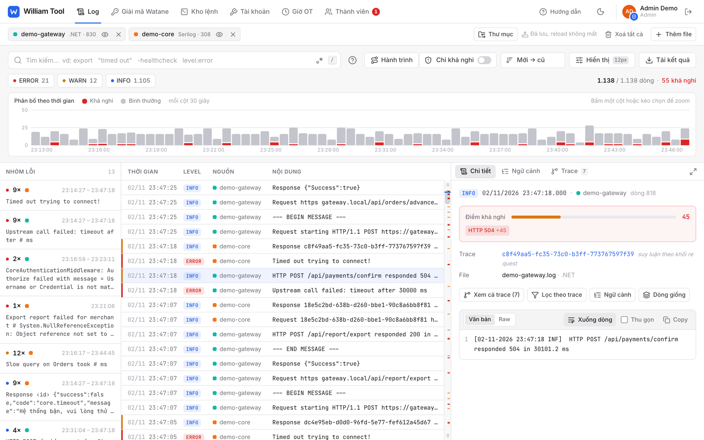

Định dạng nhận diện tự động:

| Định dạng | Ví dụ | Trace |
|---|---|---|
| Laravel | `[2026-10-09 09:09:33] staging.ERROR: …` | `"trace_id"` trong context |
| .NET | `[08-10-2026 09:30:44 ERR] <guid> …` | GUID đầu dòng |
| Serilog | `2026-10-08 08:45:52.431 +07:00 [INF] …` | `Request/Response <guid>`, các dòng khác suy ra theo khối request |
| ISO + level, ISO time, JSON lines | | `trace_id`, `request_id`, `correlation_id`… |

Cú pháp tìm kiếm:

| Viết | Nghĩa |
|---|---|
| `export timeout` | có cả hai từ |
| `export\|import` | có một trong hai |
| `"timed out"` | đúng cụm từ |
| `-healthcheck` | loại dòng chứa từ này |
| `level:error,warn` | lọc theo mức log |
| `trace:<id>` | một request cụ thể |
| `file:gw` | chỉ file có tên chứa `gw` |

Phím tắt: `/` tìm, `j` / `k` lên xuống, `Esc` xoá lọc.

### Tiện ích

Các công cụ nhỏ gom theo nhóm, tất cả chạy trên trình duyệt, không gửi dữ liệu đi đâu.

**Đọc mã QR.** Đọc từ ảnh (chọn, kéo thả, hoặc chụp màn hình rồi `Ctrl + V`), từ tab / cửa sổ đang hiện QR, từ camera, hoặc dán thẳng chuỗi QR lấy từ log. Mã VietQR / EMVCo được tách ngân hàng, số tài khoản, số tiền, nội dung, kiểu QR tĩnh / động, kèm bảng mọi trường và kiểm tra CRC (CRC sai thì app ngân hàng sẽ từ chối mã). Link, Wi-Fi và mã cài 2FA cũng được nhận ra.

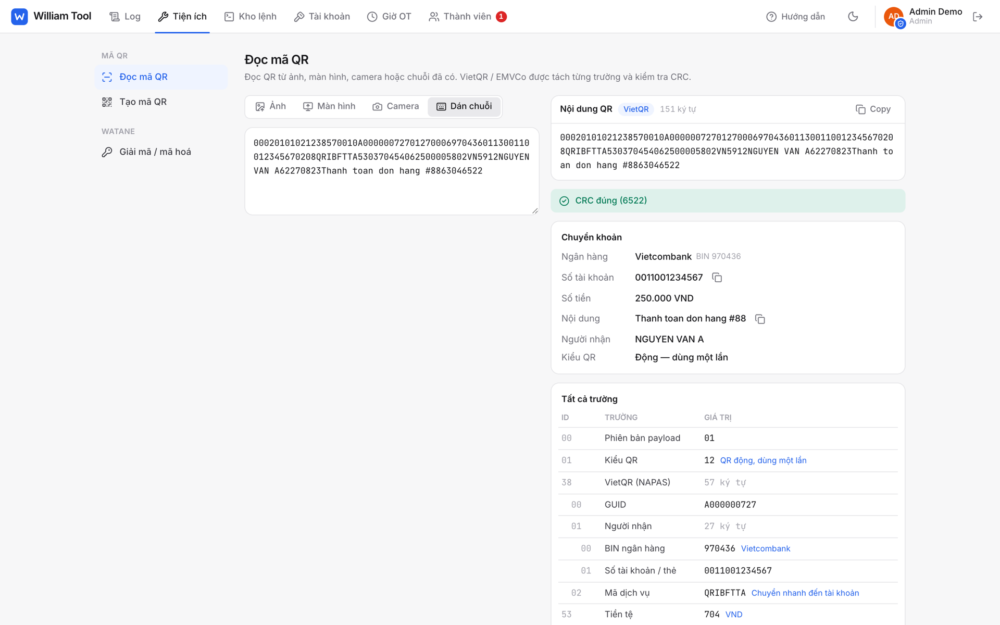

**Tạo mã QR.** Tạo VietQR chuyển khoản để test: chọn ngân hàng (hoặc nhập BIN), số tài khoản hay số thẻ, số tiền, nội dung (tự bỏ dấu). Ngân hàng và tài khoản được nhớ cho lần sau. Hoặc tạo QR cho link / văn bản bất kỳ với mức sửa lỗi tuỳ chọn. Tải PNG, copy ảnh, hoặc copy chuỗi.

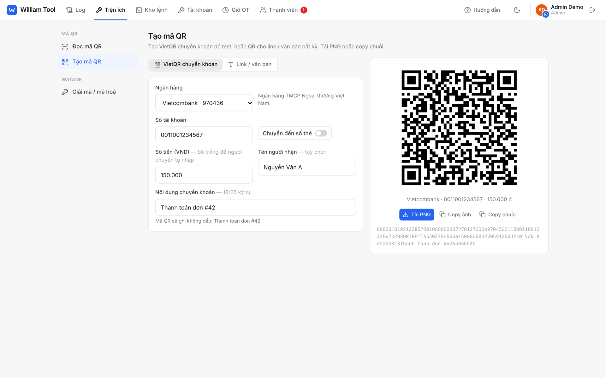

**Giải mã / mã hoá Watane.** Dán nhiều mã cùng lúc (mỗi dòng một mã) hoặc mở file CSV / Excel để giải mã cả cột rồi tải file về với cột kết quả. Lưu được nhiều secret key, tự nhận AES-128 / 192 / 256 theo độ dài key.

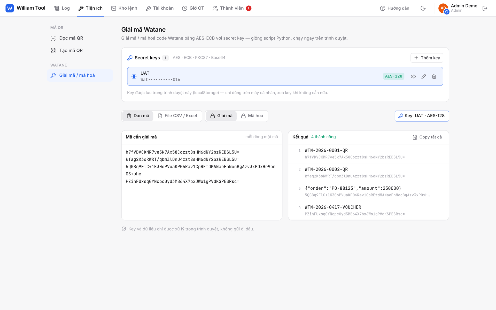

### Kho lệnh

Lệnh server, câu SQL và ghi chú dùng chung của team, lọc theo loại, nhóm và tag. Lệnh có biến dạng `{{service:watane-core}}`: điền giá trị rồi copy là chạy được. Lệnh nguy hiểm được đánh dấu, mỗi lần sửa đều có lịch sử. Phím tắt `/` tìm, mũi tên lên xuống để chọn, `Enter` để copy.

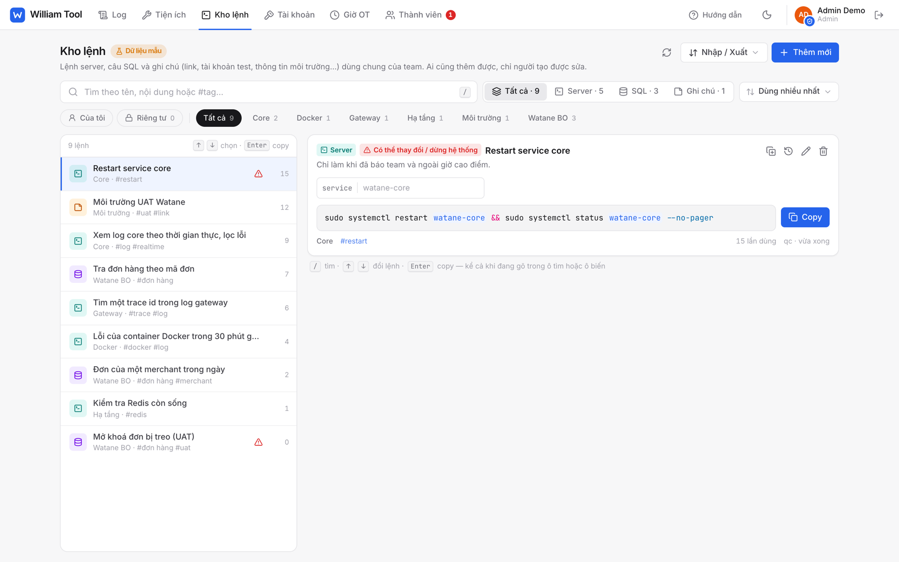

### Tài khoản dùng chung

Tài khoản test gom theo hệ thống và môi trường (UAT, SBB, Live…). Mật khẩu chỉ hiện khi bấm, mã OTP tự sinh và tự đổi theo chu kỳ. Phân quyền từng tài khoản: cả team, người được chọn hoặc riêng tư. Mọi lần xem và copy đều được ghi nhật ký. Thêm tài khoản nhanh bằng cách dán hoặc quét ảnh QR.

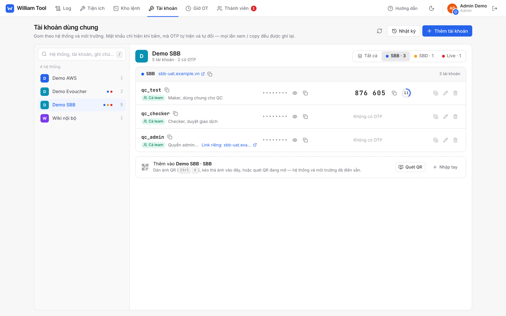

### Giờ OT

Bảng giờ OT của cả team theo tháng, mỗi cột một ngày, có tiêu đề việc của ngày đó. Tổng theo người và theo ngày, cuối tuần và ngày lễ được tô màu.

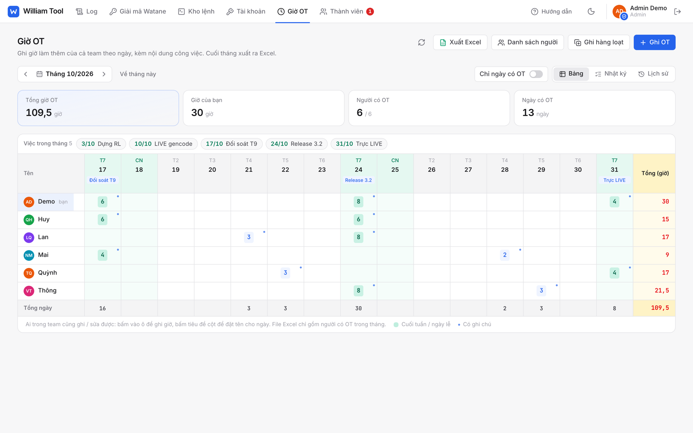

- Danh sách người OT do team tự đặt tên, không phụ thuộc tên Google. Thêm được cả người chưa có tài khoản.
- Ai trong team cũng ghi và sửa giờ cho người khác. Mọi thay đổi được database ghi lại (ai sửa, sửa gì, lúc nào) và ai cũng xem được ở mục Lịch sử.
- Ghi hàng loạt: chọn nhiều người cùng ngày, cùng số giờ và nội dung, hoặc chép lại từ ngày OT trước.
- Xuất Excel một sheet theo mẫu của team: mỗi người hai dòng (giờ và ghi chú), chỉ gồm người và ngày có OT.

| Ghi hàng loạt | Lịch sử thay đổi |
|---|---|
| 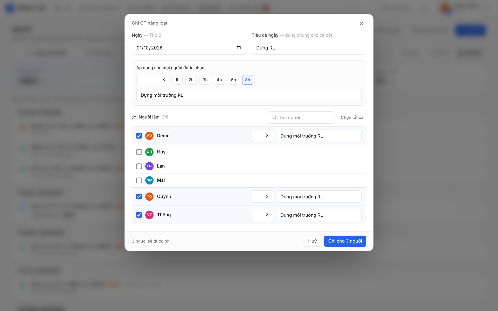 | 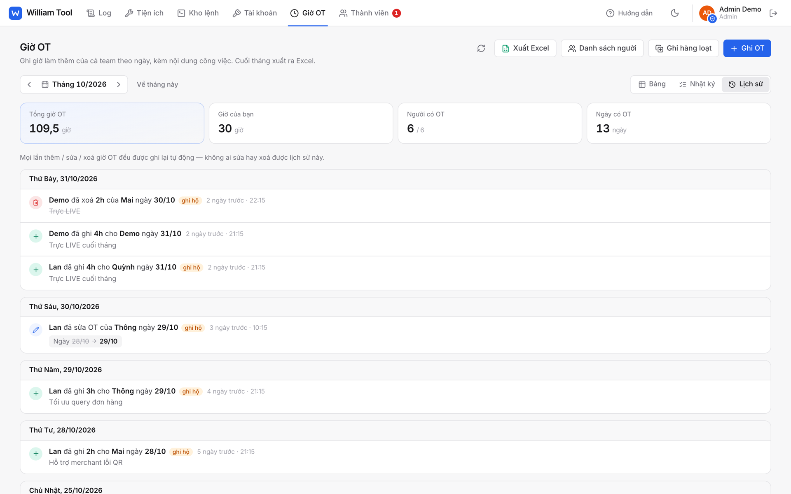 |

### Điện thoại và giao diện tối

Mọi màn hình dùng được ở bề ngang điện thoại, có thanh tab ở dưới. Giao diện sáng / tối theo máy hoặc tự chọn.

| | | |
|---|---|---|
| 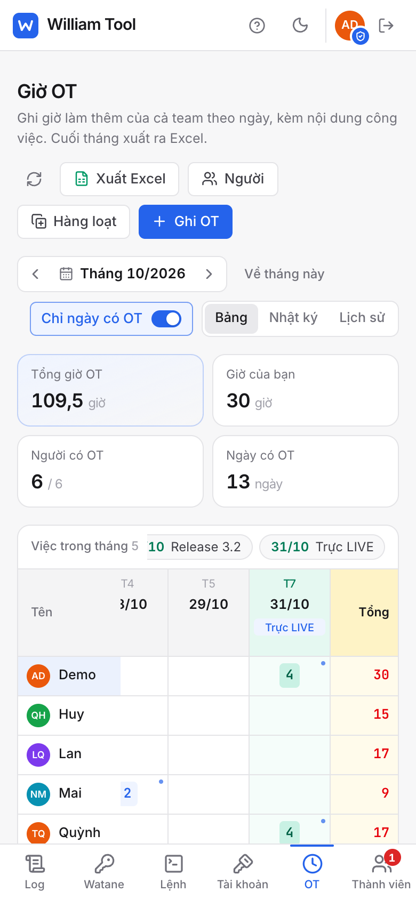 | 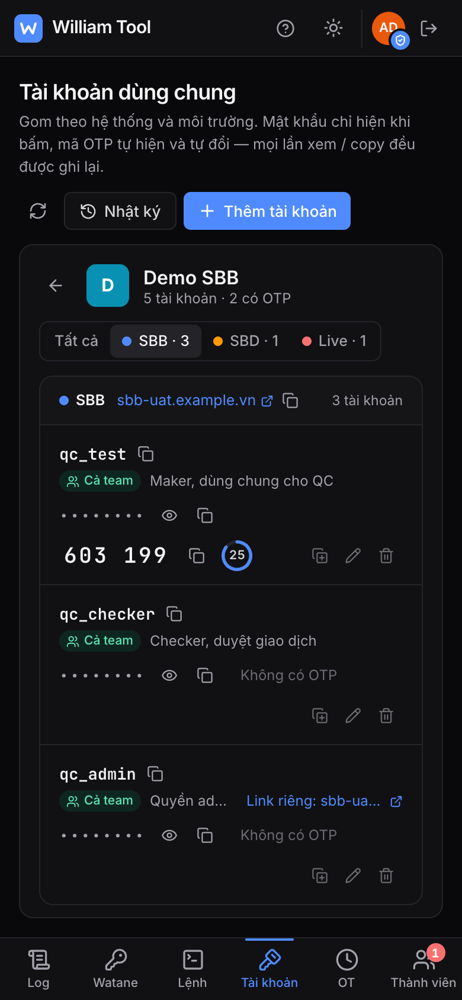 | 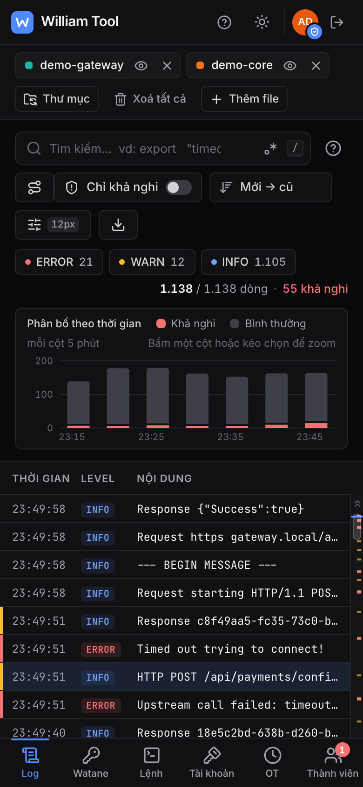 |

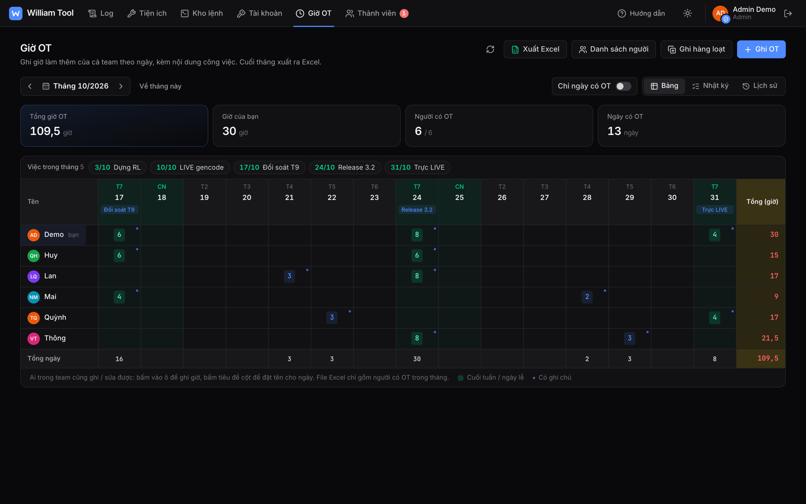

## Chạy trên máy

Cần Node 20.19 trở lên.

```bash
npm install
```

Chạy với dữ liệu giả, không cần Supabase. Tạo file `.env.local`:

```
VITE_SUPABASE_URL=demo
```

```bash
npm run dev
```

Mở `http://localhost:5173`, chọn một tài khoản demo: `admin@demo` (admin), `qc@demo` (thành viên) hoặc `newbie@demo` (đang chờ duyệt). Dữ liệu demo lưu trong localStorage và chỉ có ở chế độ dev, không bao giờ lọt vào bản build.

Chạy với Supabase thật: copy `.env.example` thành `.env.local` rồi điền URL và anon key của project.

## Cài đặt Supabase

1. Tạo project trên Supabase.
2. Mở SQL Editor, dán toàn bộ `supabase/setup.sql` rồi Run. File chạy lại bao nhiêu lần cũng được, nên mỗi khi file này thay đổi chỉ cần chạy lại nguyên file.
3. Authentication → Providers: bật Google (cần OAuth client ID / secret từ Google Cloud).
4. Authentication → URL Configuration: thêm địa chỉ web đã deploy (và `http://localhost:5173` khi dev) vào Redirect URLs.
5. Đăng nhập vào app một lần, rồi tự cấp quyền admin cho mình:

   ```sql
   update public.app_members set status = 'approved', role = 'admin' where email = 'ten@congty.vn';
   ```

   Từ đó những người đăng ký sau sẽ chờ admin duyệt ở tab Thành viên.

6. Tuỳ chọn: `supabase/seed-ubuntu.sql` nạp sẵn một số lệnh Ubuntu vào Kho lệnh (sửa email trong file trước khi chạy).

Anon key là công khai. Quyền truy cập được kiểm soát hoàn toàn bằng Row Level Security trong `setup.sql`, nên vẫn đúng kể cả khi ai đó gọi thẳng REST API.

## Build và deploy

```bash
npm run build
```

Kết quả nằm trong `dist/`: `index.html` đã nhúng sẵn JS, CSS, font và Web Worker, cùng manifest và icon để cài app. Copy cả thư mục lên bất kỳ static host nào (Vercel, nginx, S3…). Trên Vercel, đặt `VITE_SUPABASE_URL` và `VITE_SUPABASE_ANON_KEY` ở Settings → Environment Variables rồi deploy lại.

## Cài thành app

Trang web cài được như ứng dụng riêng (PWA), có icon trên Dock / taskbar và cửa sổ riêng, không lẫn vào tab trình duyệt:

- Chrome / Edge trên máy tính: biểu tượng cài đặt ở cuối thanh địa chỉ, hoặc menu → Cài đặt William Tool.
- Safari trên iPhone: Chia sẻ → Thêm vào MH chính.
- Chrome trên Android: menu → Cài đặt ứng dụng.

Cần deploy qua https thì trình duyệt mới cho cài. Chuột phải icon app sẽ có lối tắt mở thẳng từng tab.

## Extension điền tài khoản

Extension cho Chrome / Edge, dùng giống Bitwarden: bấm vào ô tên đăng nhập hoặc mật khẩu là menu chọn tài khoản hiện ngay bên dưới, chọn một tài khoản là tên đăng nhập, mật khẩu và mã OTP được điền sẵn. Cũng có thể bấm icon extension (hoặc `Alt+Shift+W`) để mở danh sách đầy đủ, có nút copy từng giá trị.

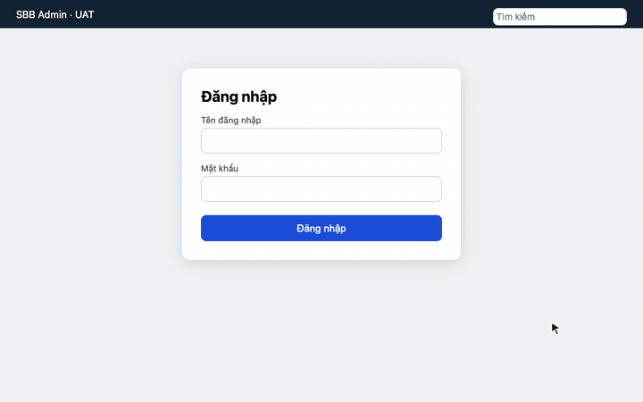

- Danh sách lấy từ tab Tài khoản, cùng phân quyền: ai không được chia sẻ tài khoản thì cũng không thấy trong extension. Mỗi lần điền vẫn được ghi nhật ký như khi bấm xem mật khẩu.
- Tài khoản có "Link đăng nhập" trùng tên miền với trang đang mở đứng riêng ở đầu, các tài khoản khác gập lại bên dưới. Chọn tài khoản của trang khác thì extension hỏi lại trước khi điền, tránh điền vào trang giả mạo.
- Mã OTP được điền vào ô OTP (một ô, hoặc mỗi ô một số). Nếu trang chưa có ô OTP thì mã được copy sẵn để dán ở bước sau.
- Menu trong trang là một khung của extension, trang web không đọc được danh sách tài khoản. Có thể đặt menu hiện ở mọi trang, chỉ ở trang có tài khoản, hoặc tắt (icon extension → cài đặt).
- Có giao diện sáng / tối. Chỉ điền khi bấm, không tự điền lúc trang vừa tải. Phiên đăng nhập của extension mất khi đóng trình duyệt.

Cài: ở tab Tài khoản bấm **Extension → Tải extension**, giải nén, mở `chrome://extensions`, bật Developer mode, bấm Load unpacked và chọn thư mục `william-tool-extension`. Chrome sẽ báo extension được "đọc và thay đổi dữ liệu trên các trang web": quyền này cần để hiện menu trong ô đăng nhập và điền vào.

`npm run build` build luôn extension (cùng cấu hình Supabase với web) và nén thành `dist/william-tool-extension.zip`, nên deploy lên Vercel là nút tải có file mới. Chỉ build riêng extension: `npm run build:extension` (thư mục `dist-extension/`).

Lần đầu dùng với Supabase thật, vào Authentication → URL Configuration, thêm `https://pmngjijejidappjlfnlmacmbfmgopchl.chromiumapp.org/` vào Redirect URLs. ID extension cố định nhờ `key` trong manifest, nên cả team dùng chung một địa chỉ này.

Muốn thử không cần Supabase: `VITE_SUPABASE_URL=demo npm run build:extension`, extension dùng các tài khoản demo.

## Cấu trúc mã nguồn

```
src/
  App.tsx              khung app: kiểm tra đăng nhập, header, các tab, tour hướng dẫn
  components/          UI dùng chung (ui.tsx, Modal, form, AppHeader, auth/, tour/)
  lib/
    backend/           truy cập dữ liệu: interface Backend, bản Supabase và bản demo
    commands.ts, ot.ts, otp.ts, format.ts
  tools/<tab>/         mỗi tab một thư mục: log, utils (QR, Watane), commands, accounts, ot, members
supabase/setup.sql     schema, RLS, trigger
extension/             extension điền tài khoản (popup, background, hàm điền ô đăng nhập), dùng lại lib/ của app
```

Quy ước chính:

- Mỗi tab chỉ phụ thuộc `components/` và `lib/`, không import lẫn nhau. Code chỉ một tab dùng thì để trong thư mục của tab đó.
- Mọi truy cập dữ liệu đi qua interface `Backend` (`src/lib/backend/types.ts`). Thêm method mới thì thêm vào cả `supabase.ts` và `demo.ts`.
- Phân quyền nằm ở database (RLS, trigger). Giao diện chỉ ẩn / hiện cho khớp.
- Thư viện nặng (exceljs, xlsx) được tải khi cần, để trang đầu mở nhanh.
- Mọi màn hình phải dùng được ở bề ngang điện thoại (375px) và chế độ tối.
- Ngày lưu dạng chuỗi `YYYY-MM-DD` theo giờ máy, không đi qua `Date → ISO` để tránh lệch múi giờ.

Trước khi commit:

```bash
npx tsc -b && npx oxlint && npm run build
```

Commit theo Conventional Commits, viết tiếng Anh. Giao diện viết tiếng Việt.
